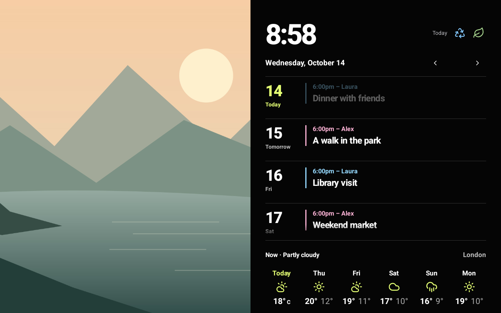
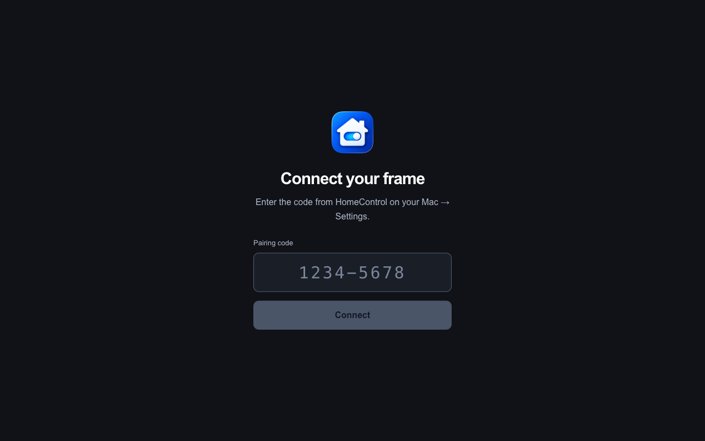

# HomeControl

A Mac app for sharing photos, calendars, collection day and weather with a household display. Choose what to share on your Mac, then pair a native Android frame or browser using eight numbers: `1234-5678`.

> **Agents: start with [AGENTS.md](AGENTS.md), then follow [docs/AGENT-SETUP.md](docs/AGENT-SETUP.md) for installation, automatic startup, kiosk setup and updates.**



*The native Android display. Photos, plans and the forecast together, with no browser required. All screenshots in this README use fictional content.*

## Set it up with your agent

Give your coding agent the repository URL and this request:

> Set up HomeControl from https://github.com/matt416/homecontrol. Read AGENTS.md, then follow docs/AGENT-SETUP.md. Build and install the Mac app and my frame, guide me through permissions and content selection, configure automatic startup for a household kiosk, and verify pairing and Wi-Fi updates. Preserve existing data and signing keys, and show me how to exit or undo the setup.

**[Open the complete agent setup guide →](docs/AGENT-SETUP.md)** It covers prerequisites, a fictional demo, installation, permissions, Mac login/sleep settings, Android default-Home setup, Wi-Fi updates and a verified handover. Your agent needs access to your Mac and display; you still approve OS permission prompts and on-device installations.

Prefer to follow along yourself? [Requirements](#before-you-start) · [Demo](#try-the-fictional-demo) · [Build and install](#build-and-install) · [Choose content and pair](#choose-content-and-pair-your-frame) · [Kiosk and updates](#everyday-use-and-updates) · [Development](#development) · [Troubleshooting](#troubleshooting)

## Before you start

- **Mac:** macOS 14+, Xcode command-line tools with Swift 5.9+, Node.js 24 LTS with npm (22.13+ also supported), and Python 3. Install Apple's tools with `xcode-select --install` if needed. Build tools are needed to build the app; the finished bundle includes its Node runtime.
- **Display:** a landscape Android tablet/frame running Android 6+ (API 23+), or a browser on the same trusted local network. Android builds also need JDK 17+ and the [Android SDK tools](frame-android/README.md#build).
- **Serving your libraries:** Photos and Calendar require an awake, logged-in Mac with HomeControl running, permission granted and sharing enabled. The frame receives content from the Mac; it does not connect directly to iCloud. The Mac can be locked while it stays awake.

### Shared Album compatibility

Keep the iPhone/iPad contributing photos and the serving Mac up to date. **Apple's newer Shared Albums, created or upgraded on iOS 27, iPadOS 27 or macOS 27, require version 27 or later to open in those devices' Photos apps.** Older, non-upgraded albums can continue to work on older software. See [Apple's Shared Album upgrade requirements](https://support.apple.com/en-us/108916).

HomeControl's macOS 14 minimum does not guarantee access to every Shared Album format. Before setup, confirm that the album appears in the serving Mac's Photos app and HomeControl's album picker. Access through iCloud.com alone is insufficient for HomeControl's local Photos integration.

> **Vibe-coded / experimental software**
>
> Built with substantial AI-assisted coding. This is a personal open-source spike, not a professionally audited or production-hardened product. Tests and demo checks do not guarantee correctness, privacy or security. Review the code before granting library access, start with the fictional demo, and use a trusted local network. Do not rely on it for critical reminders or expose the server to the internet. Provided **as is, without warranty**, under the MIT licence.

## What it does

- **Photos:** choose an iCloud Shared Album, hide photos, arrange their order and adjust slideshow timing. To add photos, share to that album from your iPhone or Mac. Both frame clients use a gentle **Ken Burns pan-and-zoom effect** in the dashboard slideshow and respect reduced-motion settings.
- **Calendar:** share multiple calendars, give each a frame colour and an optional visible name, such as **6:00pm – Laura**. These settings do not rename or recolour Apple calendars. Weather and collection details fade away while browsing dates; **Today** brings them back.
- **Collection day:** set repeating schedules for trash, recycling, green bins and brown bags. This is a built-in schedule; it does not read Apple Reminders.
- **Weather:** choose location, Celsius/Fahrenheit and timezone on the Mac. Weather starts disabled. The chosen timezone also controls the frame's clock, calendar and collection schedule.
- **Appearance:** choose one shared accent for every connected frame using preset swatches or the native macOS colour picker.
- **Pairing:** one-use codes in `1234-5678` format, valid for ten minutes. Frames keep their longer session credential internally.

### Photo framing and Apple Vision

The repository also includes an **optional local helper using [Apple's Vision framework](https://developer.apple.com/documentation/vision)**. It detects faces and people, then falls back to saliency detection to find a likely subject. Both frame clients can use that region to centre the crop and keep the subject in view during pan-and-zoom where the display's shape allows it.

**Subject detection is not enabled in the normal Mac app build today.** It requires the [optional helper setup](macos/README.md#optional-local-photo-subject-helper) with a standalone development server. Analysis stays on the Mac. Without the helper, or when it finds no subject, the slideshow uses a standard centred crop with Ken Burns motion. Ken Burns itself works without the helper.

## Try the fictional demo

After installing the build prerequisites:

```sh
git clone https://github.com/matt416/homecontrol.git
cd homecontrol
bash scripts/demo.sh
```

Open **http://127.0.0.1:8798** and enter the code printed in the terminal. Control-C stops the demo. It uses an original landscape illustration, fictional events, a sample collection schedule and simulated weather; it does not read Photos/Calendar or fetch forecasts. Restarting resets `server/data/demo/`.

<details>
<summary>Also try the native Mac controls with demo data</summary>

Leave the demo server running. Quit another running copy of HomeControl, then use a second terminal in the repository root:

```sh
bash scripts/build-app.sh
HOMECONTROL_DEMO=1 HOMECONTROL_DATA_DIR="$PWD/server/data/demo" \
  "macos/dist/HomeControl Open Source.app/Contents/MacOS/HomeControl"
```

Demo mode does not request library permissions or start another server. Weather's Search still sends the entered search to Open-Meteo. Quit and open the app normally to use your own libraries.


*The Mac preview reuses the browser client. Android has its own native interface.*

</details>

[Browse the Mac demo screenshots](docs/screenshots/README.md) or see the [standalone browser display](docs/frame.png).

## Build and install

From the cloned repository root:

```sh
bash scripts/run.sh
```

This installs locked dependencies, builds the server and browser client, bundles Node, builds and ad-hoc signs the Mac app, and opens it. The Node distribution's `LICENSE` must be beside its `bin` directory; otherwise set `HOMECONTROL_NODE_LICENSE=/path/to/that/distribution/LICENSE` when building.

The result is **`macos/dist/HomeControl Open Source.app`**. For everyday use, quit it and copy the bundle to a stable location such as `~/Applications/`, then open that copy. **The app starts its server automatically; no server terminal needs to stay open.** It builds for the current Mac architecture. This source release is not notarized and is not an App Store installer.

For an Android display, follow [the Android build and install guide](frame-android/README.md#build). Build the Android APK **before** building the Mac app to bundle it for Wi-Fi updates. Initial installation normally uses USB; normal use and subsequent updates use Wi-Fi. Preserve the private signing key so future updates can replace the installed app.

## Choose content and pair your frame

1. Open **Photos** and **Calendar**. Each page requests its own permission before showing library controls. If access was denied, use its button to open Privacy & Security settings and allow **HomeControl Open Source**.
2. Choose a shared album and/or calendars, then click **Start Sharing**. You can share either library independently. Calendar selection, frame colours and optional names are inline on the Calendar page.
3. In **Collection day**, enable the collections you want, choose their repeating schedules and save.
4. In **Weather**, search for a location, select a result, choose units and save. Manual coordinates and timezone are under Advanced.
5. Open **Settings** for the frame address and pairing code. Local-network access starts automatically; allow it if macOS asks.
6. Open the installed **HomeControl Frame** Android app. Select the Mac it discovers on the same Wi-Fi and enter the code. Use the manual address option if discovery is blocked. For a browser display, open the address from Mac Settings and enter a code.


*Select the shared album, choose its photos and adjust slideshow timing on the Mac.*


*Choose several calendars, give each a colour, and optionally show a name beside event times.*

<details>
<summary>Collection day and weather settings</summary>


</details>

### Frame appearance

In **Settings → Frame appearance**, choose a Tailwind colour swatch or open the native macOS colour picker. The shared accent reaches Android and web displays within a few seconds.


### Browser pairing and the Mac preview

Settings shows the Mac's `.local` hostname on port 8797. **Frame Preview** uses the browser client inside the Mac app; a browser on that Mac can also use `http://127.0.0.1:8797`. Other devices use the address shown in Settings. Guest networks may block connections between devices. Browsers use the address directly; native Android supports Bonjour discovery.

Pairing codes expire and work once. Choose **New Code** for each additional frame.

<details>
<summary>See the browser pairing screen</summary>



</details>

## Everyday use and updates

HomeControl lives in the Mac menu bar. Opening its settings window shows a Dock icon; closing the window hides that icon while the app and server keep running. Photos/Calendar updates stop if the Mac sleeps, shuts down or the app quits.

On Android, swipe photos to browse and tap for full screen; use Back or a two-finger hold for settings. Browser settings are available through a triple-tap or the keyboard Settings button. Both clients let you pause photos and disconnect.

### Automatic startup and kiosk use

For a dedicated display, choose HomeControl Frame as Android's default Home/launcher app. Add the Mac app to Login Items and configure the Mac to stay awake on mains power if you want continuous service. The [kiosk setup guide](docs/AGENT-SETUP.md#5-set-up-everyday-kiosk-use) covers the exact checks, how to exit, and how to undo these changes. Startup after boot/login depends on the device's unlock requirements and must be verified on your hardware. The build script does not install a login service.

### Wi-Fi updates

Keep the Android frame on reliable wall power and on the same network as the Mac. A computer USB port may not power a continuously running display reliably.

Once a newer release signed with the same key is available, choose **Mac Settings → Frame updates → Send Update**, then confirm **Install** on the frame. Pairing and photo settings stay in place. See [Android update instructions](frame-android/README.md#updates-over-wi-fi) to build and publish a release.

**Android 6 requires the global Security → Unknown sources switch.** This allows installing apps outside the Play Store. Leave it enabled for future Wi-Fi updates, or disable it afterward and re-enable it for the next update. Your agent should explain this choice before changing it. Newer Android versions may use a per-app **Install unknown apps** grant instead. Installation still requires confirmation on the device.

### Quitting the Mac app

Quit presents a **Keep the frame server running** checkbox, unchecked by default:

- **Unchecked:** quit HomeControl and stop its server.
- **Checked:** quit the app and keep the server available. Reopening the app reconnects to that server.

The server alone cannot refresh Photos/Calendar; the last export expires after ten minutes. Weather and collection settings can continue to be served while the Mac stays awake. A disconnected Android frame can retain cached content locally; stopping sharing is not remote erasure.

Updates retain the `org.homecontrol` app identities and private data directory. Locally rebuilt, ad-hoc signed Mac apps may need library permission again.

## Development

### Separate packages, one repository

Each part has its own build and README. There is no root npm package or workspace manager. Clone the whole repository: the JavaScript packages use a local `file:../contracts` dependency.

| Package | Purpose |
| --- | --- |
| [`macos/`](macos/README.md) | Swift Mac app; controls its bundled local server |
| [`server/`](server/README.md) | Shared API for both displays; also serves the browser build |
| [`frame-android/`](frame-android/README.md) | Native Java Android display, with its own APK and tests |
| [`frame-web/`](frame-web/README.md) | React browser display, also used by the Mac's Frame Preview |
| [`contracts/`](contracts/README.md) | Payload validation and shared schedule/date helpers |

Android and browser are separate display clients. UI changes may require work in both; content export, weather settings, pairing and serving are shared. The Mac preview reuses `frame-web`. Scope is Photos, Calendar, collection day and Weather; camera, plant-care and home-automation integrations are excluded.

### Build individual packages

```sh
(cd contracts && npm ci && npm run build)
(cd server && npm ci && npm run build)
(cd frame-web && npm ci && npm run build)
```

Use `bash scripts/build-app.sh` to package the complete Mac app. Android's tools, APK build and emulator checks are in its [package README](frame-android/README.md); Node and the web client are not required on the Android device.

### Run a standalone development server

Stop the app-owned server before starting another on the same port:

```sh
cd server
npm run setup
npm start
```

`npm run setup` creates a private `.env` with a random credential and preserves existing settings. The sanitized [`.env.example`](server/.env.example) contains placeholders only. These commands run from `server/`. To use Mac controls with a manually started server, launch the app executable with `HOMECONTROL_EXTERNAL_SERVER=1`.

For browser development, run `npm run dev` in `frame-web/` with the server on 8797, then open `http://127.0.0.1:5173`. Each browser origin has its own pairing session. Rebuild contracts after changes.

### Checks

```sh
bash scripts/test.sh
bash frame-android/test.sh  # requires a JDK on PATH
bash scripts/build-app.sh
```

The main checks cover Swift and JavaScript tests, types/lint/format/build and dependency licences. Android has host tests and emulator instrumentation. CI builds the Mac app and runs Android host tests. See [verification notes](docs/verification.md) for tested behavior and remaining gaps.

## Configuration and privacy

Normal app-managed files live outside the checkout:

```text
~/Library/Application Support/HomeControl Open Source/
  Frame/             selected content and weather/collection settings
  Server/server.json private session and local-control credentials
  Server/server.log  local startup diagnostics
```

Change the shared content folder through **Settings → Advanced**; the app updates its server automatically. The app-managed server uses `server.json`, not the development `server/.env`. Keep both credential files out of the repository and issues.

For standalone server configuration, see [`.env.example`](server/.env.example). `APPLE_EXPORT_DIR` must match the Mac export folder; `FRAME_WEB_DIR` defaults to `../frame-web/dist`. `HOST`, `PORT` and `PUBLIC_ORIGIN` must agree with the display's address. The server rejects unrecognized hosts and origins.

No analytics or cloud account is required. Photos/events are served locally to paired clients. Place searches and forecast coordinates go to Open-Meteo. Plain HTTP does not encrypt content or credentials in transit: use a trusted local network and keep the server off the public internet.

All frames currently share one session credential; there is no per-device revocation. **Disconnect** clears that client's stored credential. Android caches data/photos for offline display; clear its app storage to remove its local cache.

<details>
<summary>Revoke access for all paired frames</summary>

Stop the server. Generate a replacement credential:

```sh
node -e "console.log(require('node:crypto').randomBytes(32).toString('hex'))"
```

Replace `token` in the app's private `server.json`, or `FRAME_TOKEN` in the standalone `.env`. Preserve `controlToken`, which restricts app lifecycle controls to authenticated local requests. Reopen/restart, then pair each display again. Keep the replacement credential private.

</details>

## Troubleshooting

| Symptom | Next step |
| --- | --- |
| Photos/Calendar asks for permission | Use that page's Allow Access button; previously denied access must be enabled in System Settings. |
| Permission button does nothing in a demo | Quit demo mode and open the packaged app normally. |
| Shared album missing | Check [Shared Album compatibility](#shared-album-compatibility), enable Shared Albums in Photos → Settings → iCloud, and confirm the album appears in Photos on the serving Mac. |
| No photos after selecting an album | Share photos to that named iCloud Shared Album from your iPhone or Mac; start sharing and let iCloud sync. |
| No events | Choose calendars, enable sharing and confirm permissions. |
| Frame server offline | Settings → Advanced → Restart Server / Open Server Log. Check that another development server is not using 8797. |
| Another device cannot connect | Check that the Mac is awake and the app is open; check firewall, hostname and guest Wi-Fi isolation. |
| Code rejected | Get New Code. After too many attempts, wait a minute. |
| Weather missing | Choose a location, enable weather and save; allow up to one minute. |
| Shared contracts cannot resolve | Build `contracts` first and keep the sibling package folders together. |

For installation, upgrades or recovery, start with the [agent setup guide](docs/AGENT-SETUP.md).

## Licences and contributions

HomeControl source, original blue house/switch branding and demo artwork are **MIT**. Keep [`LICENSE`](LICENSE), [`THIRD-PARTY-NOTICES.txt`](THIRD-PARTY-NOTICES.txt) and relevant attribution when redistributing.

- UI icons: **Lucide ISC**, with **Feather-derived MIT** portions. No SF Symbols artwork or font files are distributed.
- JavaScript dependencies: separately locked per package and audited in [`third-party/dependencies.json`](third-party/dependencies.json). Android uses platform APIs, with no additional runtime libraries.
- Bundled **Node.js**: its distribution licence and dependency notices are included in the app's `Contents/Resources/Runtime/LICENSE-Node.txt`.
- **Apple frameworks/macOS and the Android SDK** are platform/toolchain dependencies and are not redistributed in this source release. HomeControl's MIT licence does not relicense those platforms.
- **Open-Meteo** weather data is [CC BY 4.0](https://open-meteo.com/en/terms). Its free hosted API is for [non-commercial use](https://open-meteo.com/en/pricing); commercial use requires appropriate service terms or another provider.
- Accent swatches: **Tailwind CSS MIT** palette values, with attribution; no Tailwind runtime is bundled.
- **resvg-js MPL-2.0** is an unmodified development-only icon renderer, excluded from the application runtime.

Read [licence provenance](third-party/README.md). Contributions should include reproduction steps and verification with fictional data; keep private exports, keys, tokens and `.env` files out of attachments.
