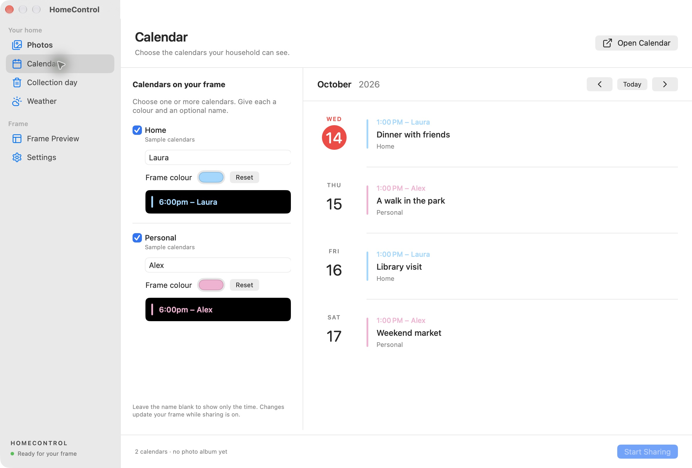
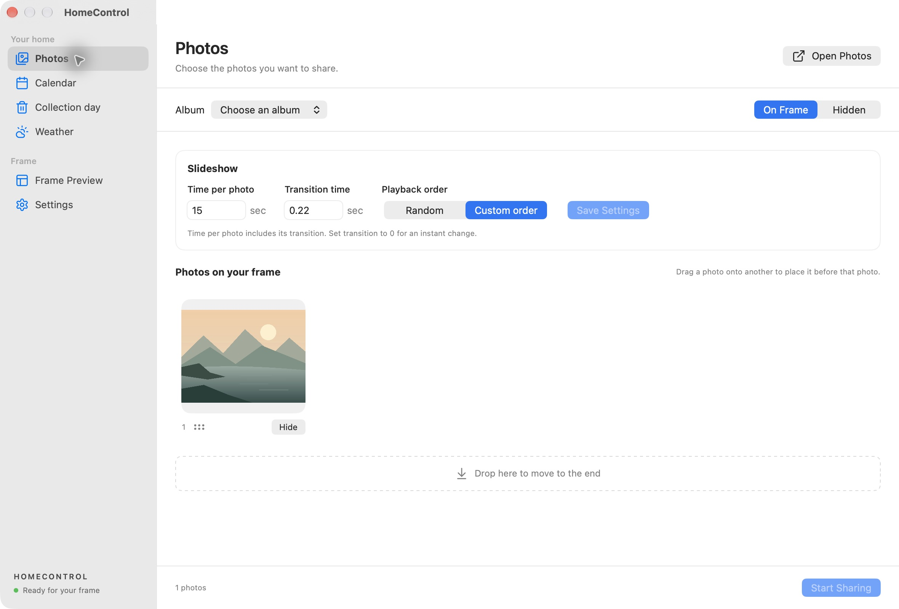
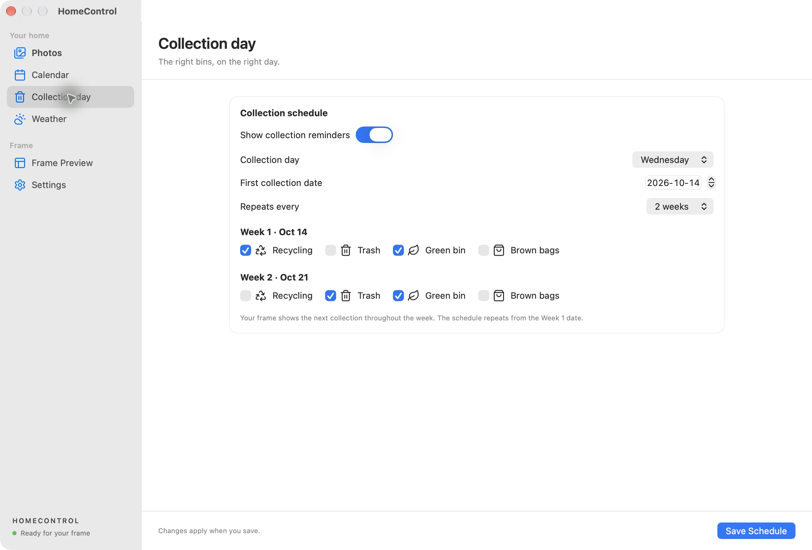
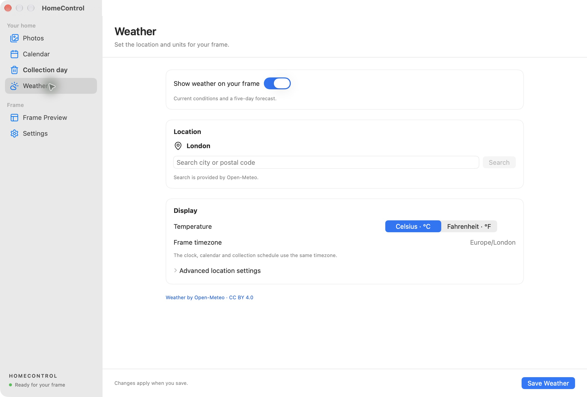
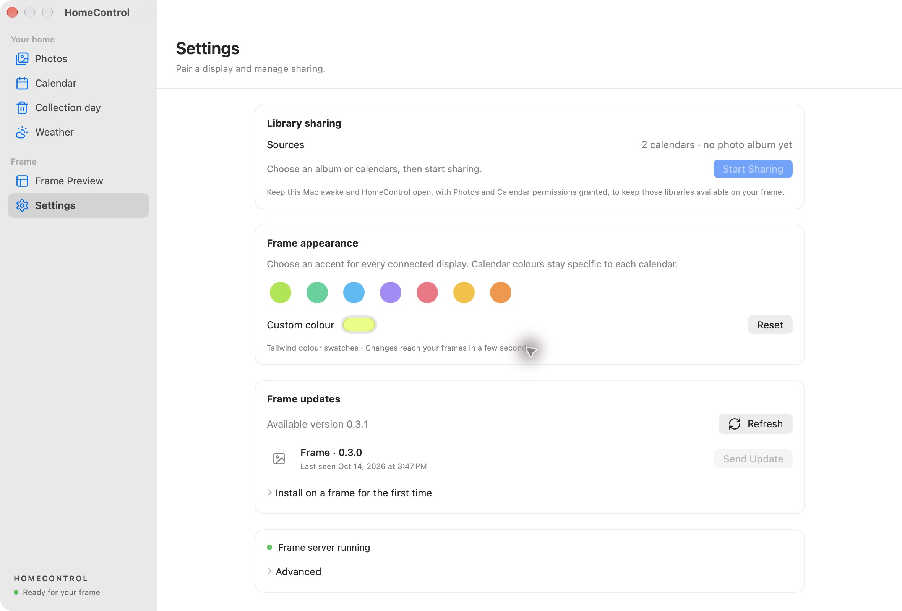
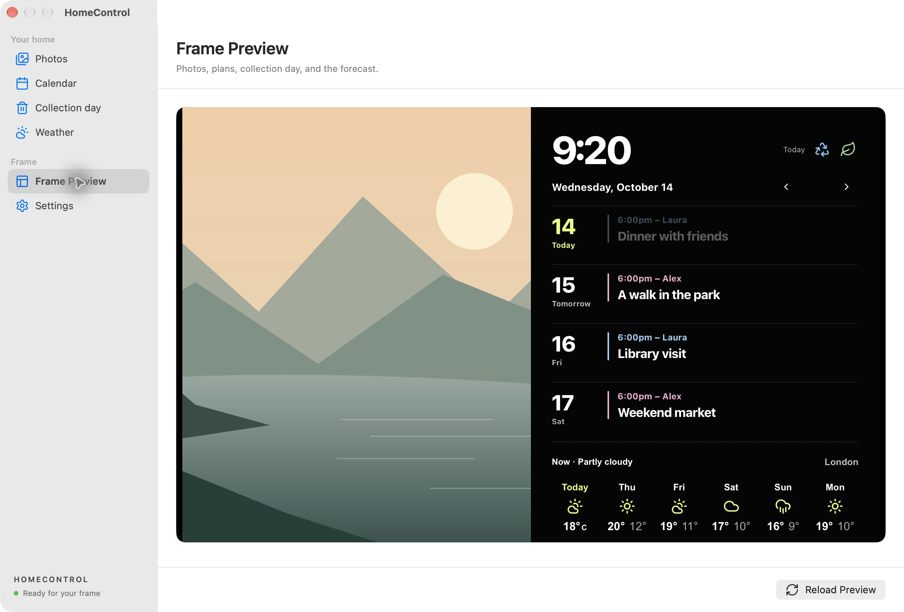

# Mac demo screenshots

Captured from the packaged HomeControl app with fictional content. These are running UI captures, not design mockups. The frame screenshots live in the parent documentation directory.

